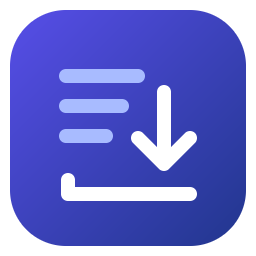

  

<h1 align="center">SegmentDesk</h1>

基于 N_m3u8DL-RE 的 Flutter 流媒体下载桌面客户端

  <a href="https://github.com/evan-dev0608/segmentdesk/releases">下载</a> ·
  <a href="docs/usage.md">使用说明</a> ·
  <a href="desktop/README.md">从源码运行</a> ·
  <a href="https://github.com/nilaoda/N_m3u8DL-RE">上游核心</a>

SegmentDesk 把流媒体下载、任务日志和核心更新放在一个桌面窗口里。粘贴 HLS、DASH 或 MSS 清单链接，选择保存目录，就可以发起下载。下载能力由 [N_m3u8DL-RE](https://github.com/nilaoda/N_m3u8DL-RE) 的官方发行包提供，核心可在客户端内独立更新。

## 功能

- **下载工作台** · 添加链接或本地清单，查看任务阶段和日志，打开输出目录或重试失败任务。
- **高级选项** · 读取当前核心的帮助，提供搜索、开关、文件选择及可重复参数。
- **轨道与频道选择** · 读取轨道后图形化挑选视频、音频、字幕和点播分段；从本地或远程 M3U 中勾选 IPTV 频道。
- **本地媒体处理** · 在工作台右上角「更多操作」选择本地媒体文件。已完成任务也可以从任务菜单打开输出目录里的媒体。有 FFmpeg 时可封装为 MKV，其他操作取决于核心提供的工具。
- **核心管理** · 按系统和架构安装官方发行包，校验大小与 SHA-256。GitHub API 限流时回退到官方发行页，并标注本次是否完成校验。
- **外观和下载偏好** · 支持深色模式、主题色、默认保存目录及混流格式。

## 开始使用

1. 运行客户端。启动时会检查核心和 FFmpeg。如果缺少核心，打开 **设置 → 下载核心 → 安装核心**。
2. 如果提示找不到 FFmpeg，把它加入 PATH 并重启客户端。
3. 点击 **新建下载**，粘贴清单链接，选择目录，再点击 **开始下载**。

[GitHub Releases](https://github.com/evan-dev0608/segmentdesk/releases) 提供 Windows x64、macOS ARM64 和 Linux x64 安装或运行包。Windows 提供安装版和免安装 ZIP，首次使用推荐安装版。三端均已通过 CI 构建，macOS 与 Linux 仍待实机验证。详见 [使用说明](docs/usage.md) 和 [构建说明](desktop/README.md)。

## 从 Chrome 发送到客户端

1. 从 [GitHub Releases](https://github.com/evan-dev0608/segmentdesk/releases) 下载 Chrome 扩展 ZIP，按 [扩展安装说明](browser-extension/README.md) 加载。
2. 打开视频网页，在扩展中点击 **开始检测**，然后播放视频。检测到 HLS 主清单时，优先选择标有 **可选画质** 的结果。
3. 点击 **发送到客户端**，在 SegmentDesk 的 **确认下载** 弹窗检查链接和保存位置。需要手动选轨时，打开 **高级选项 → 读取轨道**。

一键导入需要包含 Chrome 通信宿主的 Windows 安装版。也可以在扩展里 **复制** 链接，再粘贴到桌面客户端。实际可下载的资源类型取决于已安装的下载核心。

核心更新在 **设置 → 下载核心**。SegmentDesk 自身的发布包在 **设置 → 客户端 → 查看客户端更新**。

## 在 GUI 中使用上游参数

**设置 → 下载偏好**管理普通下载的默认目录和混流格式。需要为某次任务配置请求头、轨道筛选、限速或录制时长时，从 **新建下载 → 高级选项** 进入，在搜索框输入参数名或说明，再填写对应控件。

| 想做什么 | 在「高级选项」中查找 |
| --- | --- |
| 给清单和分片请求附加 Referer、User-Agent 等请求头 | `--header` |
| 设置代理、下载线程、重试次数和限速 | `--custom-proxy`、`--thread-count`、`--download-retry-count`、`--max-speed` |
| 仅下载字幕，或按规则选择视频、音频和字幕 | `--sub-only`、`--select-video`、`--select-audio`、`--select-subtitle` |
| 图形化挑选轨道、点播分段或 IPTV 频道 | 地址框下方的「读取轨道」「本地 IPTV」「远程 IPTV」，无需手填筛选表达式 |
| 下载一段范围，或限制直播录制时长 | `--custom-range`、`--live-record-limit` |
| 自定义混流或附加字幕文件 | `--mux-after-done`、`--mux-import` |

表单以已安装核心的帮助为准。参数值和可用范围详见 [GUI 填写示例](docs/usage.md#本地清单与高级选项)和 [上游命令行文档](https://github.com/nilaoda/N_m3u8DL-RE#命令行参数)。

## 当前范围

客户端每次运行一个任务。高级参数及文件工具的可用范围取决于已安装的核心版本：选轨需要 `--select-video`，点播选段需要 `--vod-drop-parts`，工具子命令需要核心实际注册。Python 原型仍保留在仓库根目录，作为功能对照，不再是运行时的必需组件。

## 许可证与致谢

SegmentDesk 以 [MIT License](LICENSE) 发布。下载核心来自 [nilaoda/N_m3u8DL-RE](https://github.com/nilaoda/N_m3u8DL-RE)，上游以 [MIT License](https://github.com/nilaoda/N_m3u8DL-RE/blob/main/LICENSE) 发布。上游文档明确要求仅用于学习和技术研究、只下载有合法权限的内容；使用本客户端时同样请遵守该范围及所在地的法律法规。感谢上游作者与贡献者。
